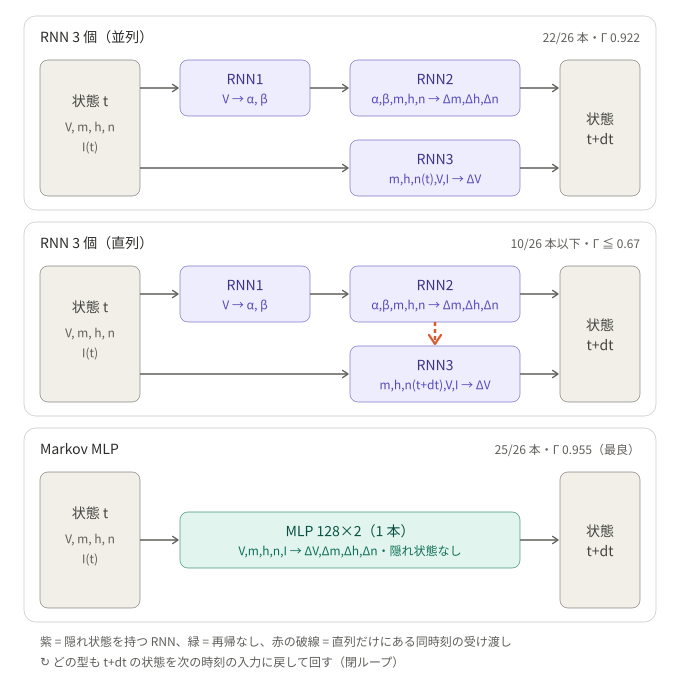
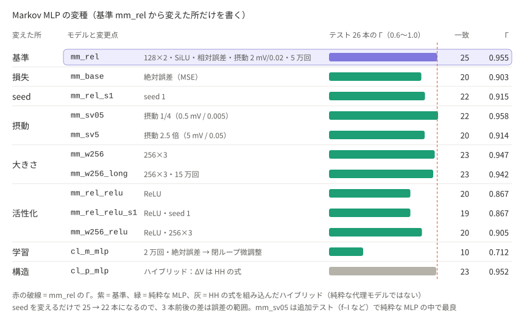

# RNN Neuro Surrogate
### RNNを用いた神経細胞モデル（Multi-Compartmentモデル）の代理モデル構築による高速シミュレーション
脳の神経細胞、ニューロンは、外から電気的な刺激を受けると、細胞内の電位が変化し、閾値を超えると「発火」と呼ばれる鋭い電気信号を出します。
この発火現象は、これまで連立非線形な微分方程式のモデルを用いて再現が可能ですが、計算に時間がかかるという問題があります。
そこで、RNN（再帰型ニューラルネットワーク）に微分方程式の解の挙動を学習させ、行列の掛け算だけで発火を再現できる代理モデルを作り、GPUを用いて高速にシミュレーションできるようにすることを目指しています。

## 週の報告

### 11/16(月)〜11/20(金)
- やったこと
  - HH の代理モデルを PyTorch で書き直し、学内サーバの GPU で学習できるようにしました
  - 構造の違う代理モデルを比べました（全 48 本、一覧は [HHモデル一覧.xlsx](results/HHモデル一覧.xlsx)）
    - RNN 3 個（並列）：閉ループで回した誤差を損失にする微調整で、テスト 26 本中 22 本
    - RNN 3 個（直列、ホワイトボードの構成）：5 設定とも 6〜10 本で、並列より悪い
    - 再帰のない MLP（Markov MLP）：25 本で最良（Γ = 0.955）
  - 評価の指標に coincidence factor Γ（スパイク時刻の一致度、1 で完全一致）を加え、全モデルを採点し直しました
  - 26 本とは別の追加テスト 125 本（f–I 曲線、seed 違い、20 秒の長時間、学習範囲の外）で上位 8 モデルを採点しました
  - Traub に移植した後の学習と評価の計画を立てました（[計画](experiments/traub_surrogate/移植後の学習と評価の計画.md)）
- 分かったこと
  - HH は $(V, m, h, n)$ が分かれば次の時刻が決まるので、状態をすべて入力に戻せば RNN の隠れ状態は要らない
  - 発火率は HH と合うが、定常電流を 1 秒流すとスパイク時刻が少しずつずれていく
  - 26 本の成績だけではモデルを選べない（追加テストでは別のモデル mm_sv05 が全セットで上、seed を変えるだけで 3 本動く）
  - HH 単体では代理モデルの方が 1 ステップの計算量が数百倍大きく、速度では勝てない。速度の比較は Traub で行う
- 困っていること
  - ゆっくり上がるランプ電流で、発火が始まるタイミングがずれるのが直っていません
- 来週のTODO
  - HH で決めた作り方（Markov MLP、閉ループ微調整）を Traub に移す
  - Traub の教師データを計画の量（200 軌道 × 2〜5 s）で作る

### 11/9(月)〜11/13(金)
- やったこと
  - 学内サーバ（GPU）で学習できる環境を作りました
  - flow function の論文コードで、論文の図 3（損失の分布）を出す手順を整えました
  - Learning flow functions の構造と前提知識をドリル形式でまとめました

### 11/2(月)〜11/6(金)
- やったこと
  - Learning flow functions of spiking systems の論文コード（L4DC 版）を手元で動かせるようにしました

### 10/23(金)〜10/31(金)
- やったこと
  - Traubモデルの実装のための勉強を行いました（はじめての神経回路シミュレーション を読む）
  - 論文読み
    - Learning flow functions of spiking systems（[原稿](references/reviews/learning_flow_functions/論文紹介_learning_flow_functions.md)）
    - Traub1991_CA3
- 困っていること（どれも時間が解決しそうですが。進捗が遅いという意味で悩んでいます）
  - 論文の学習タスクが複雑なので理解に時間がかかっています
  - マルチコンパートメントモデルの膜電位応答の学習の仕方を検討しているところです（入力箇所が複数あるので入力電流を工夫する必要がある）
  - エンコーダー、デコーダーの知識が要ります
  - 次に読む論文をどれにするか
- 来週のTODO
    - 参考書にTraubモデルのC言語による実装があったのでそれをPythonに移行
    - Traubモデルから教師データを作成する
    - 再来週から教師データを、エンコーダーデコーダーLSTMに学習させる

## HH 代理モデルの構成（図）
取り組んだ順は、RNN 3 個（並列、10/16〜11/16）→ Markov MLP（11/18〜11/19）→ RNN 3 個（直列、11/19〜11/20）。

### 三つの構成の違い

並列と直列の違いは、RNN3 が受け取る m, h, n が時刻 t の値か、RNN2 が出したばかりの t+dt の値か、だけである。Markov MLP は隠れ状態を持たず、(V, m, h, n, I) から 4 つの増分を 1 本の MLP で出す。

### Markov MLP の変種

ネットワーク自体は普通の FFNN（Linear + SiLU を 2 段）で、違いは使い方と学習のさせ方にある。出力の増分を状態に足して次の入力に戻す。学習では教師の状態に摂動を足し、正解は HH の式（オイラー法の 1 ステップ）から計算する。ΔV は相対誤差で測る。

## 全体の進捗
- 生理学的基礎知識（済, 〜6月）
  - 先行研究調査：棟近さんの SINDy による代理モデル、Learning flow functions of spiking systems
- HHモデルのオイラー法シミュレーション（済, 〜6月）
  - FitzHugh-Nagumo 方程式と HH モデルを数値計算した
- RNNの基礎知識（済, 7月〜10/2）
  - 詳解ディープラーニング 5章まで
  - NumPy で順伝播・BPTT・Adam を自作し、sin 波を学習できることを確認した
- HHモデルの代理モデルをRNNで作成
  - 教師データ作成（済, 9/25〜10/9）
    - 陽的オイラー法、dt = 0.01 ms、900 ms（90,000 ステップ）
    - 初期状態：V(0) = −65 mV、m, h, n はその電位での定常値
    - 入力電流：10 ms ごとに 0〜20 µA/cm² の一様乱数で変わる階段状の電流（seed = 0）
  - モデル1：RNN 1個で I → V（済, 10/9）
    - どの電流でもスパイクを出さず、電流に応じた平均的な膜電位だけを出力した
  - モデル2：RNN 3 個（HH の式に合わせた分割型）（済, 10/9〜11/20）
    - 初期版は閉ループで V が −110 mV に落ちた。変化量を出す形・値域の制約・教師データの変更で 19/26 本、閉ループ微調整で 22/26 本
    - 直列版も試したが 10/26 本以下
  - モデル3：Learning flow functions of spiking systems の方法（済, 10/30〜11/16）
    - 論文コードのまま学内サーバで 10 本学習。対象の HH と評価が違うので、ほかのモデルとは直接比べられない
  - Markov MLP（再帰なし、状態を全部戻す）（済, 11/19〜11/20）
    - テスト 26 本中 25 本、Γ = 0.955 で最良
  - 追加テスト（f–I、seed 違い、長時間、学習範囲の外）（済, 11/20）
- Multi-Compartmentモデルの実装（済, 〜10/30）
  - Traub の 19 コンパートメントモデル（CA3 錐体細胞）を、参考書の C 言語版から NumPy に移植した
  - 複数のニューロンをまとめて計算できるようにした
- Multi-Compartment × 代理モデル（進行中, 〜2026年末）
  - Traub への RNN 3 個型の移植（動作確認まで済, 11/16。12 軌道 × 150 ms、50 エポック）
  - HH で決めた作り方を移し、精度と速度を元の Traub モデル（GPU で並列化した版）と比べる（[計画](experiments/traub_surrogate/移植後の学習と評価の計画.md)）
- 卒論執筆（初稿 〜2027/1/20、提出 〜2027年3月）
