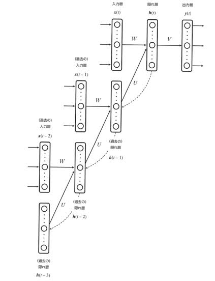
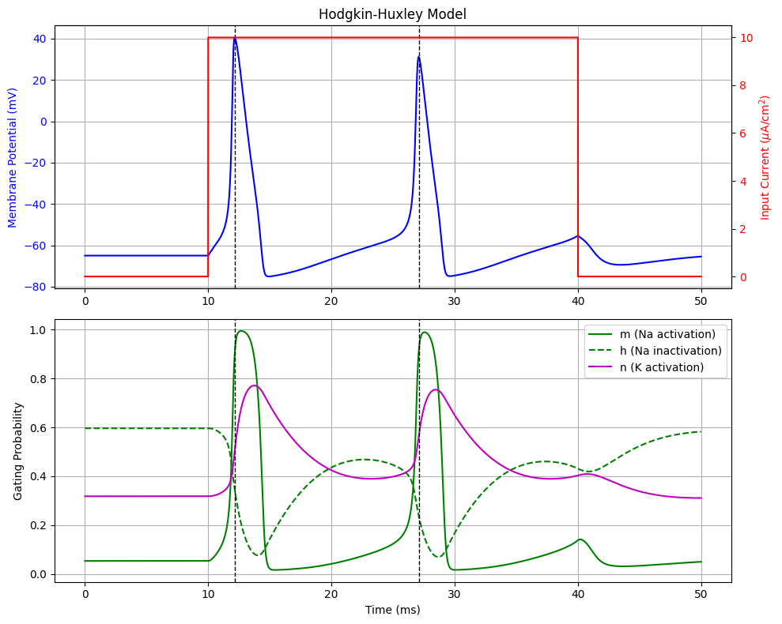
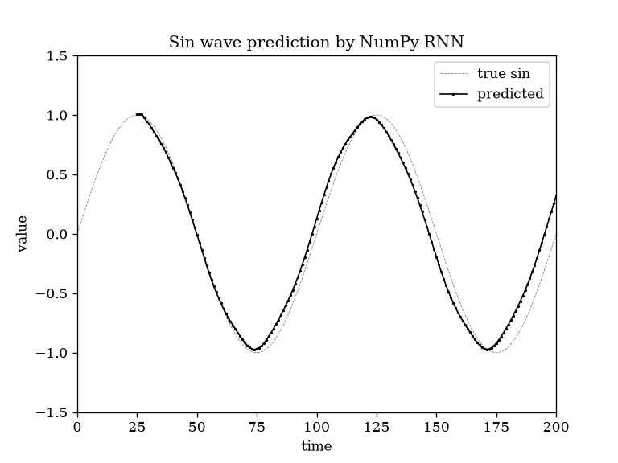
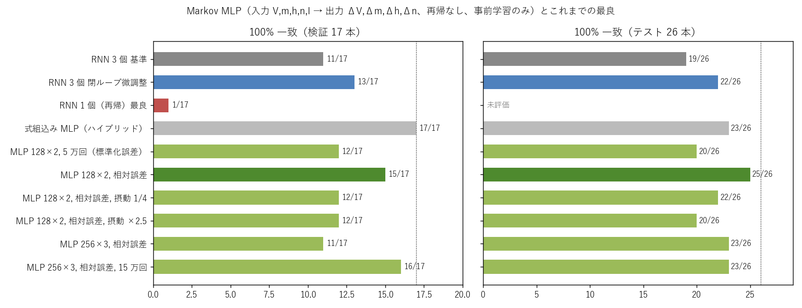
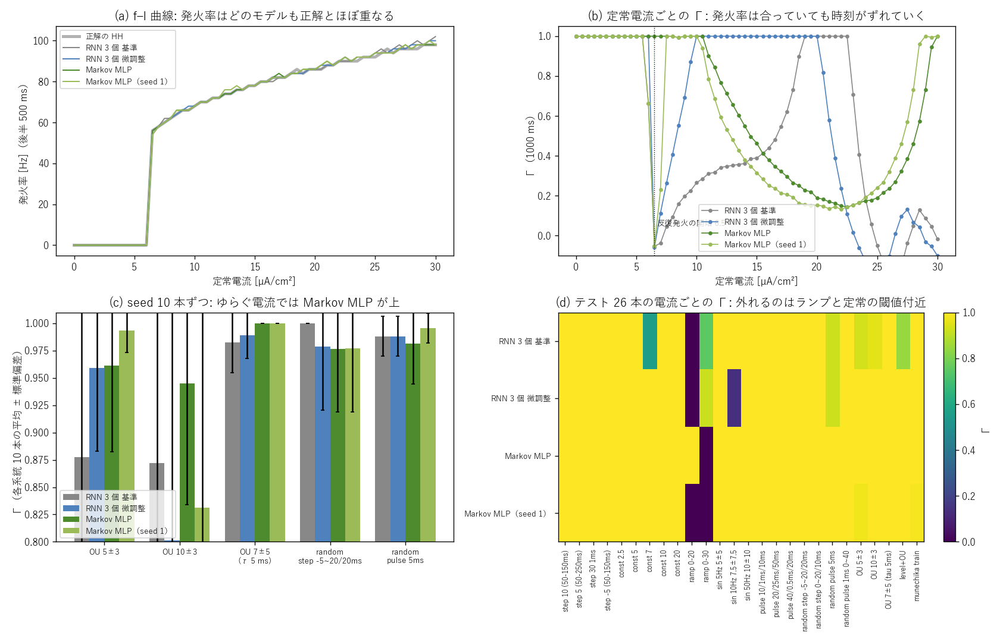
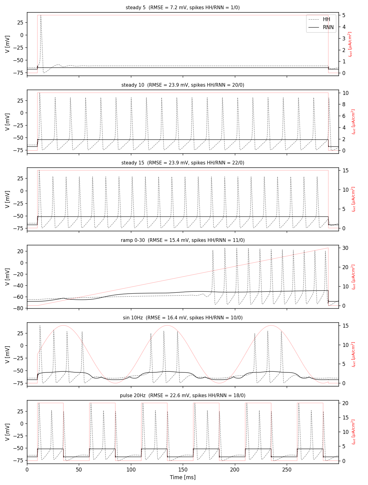
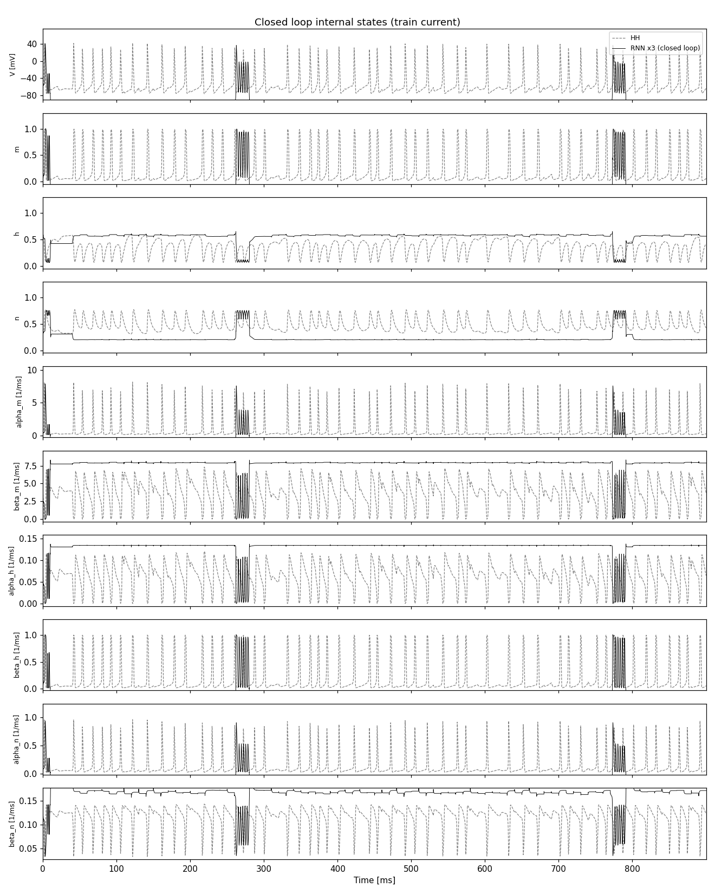
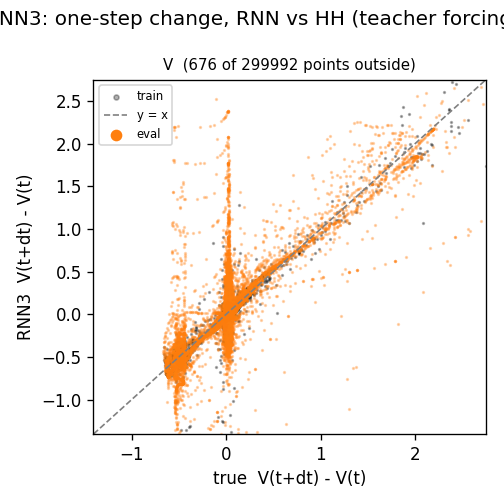

# RNN Neuro Surrogate
### 神経細胞シミュレーションの計算コスト削減を目的とした RNN 代理モデルの構築

大規模な脳シミュレーションでは、ニューロンモデルの微分方程式を数値積分する計算と、モデルが持つ状態変数を保存するメモリが大きな負担になる。本研究では、ニューロンモデルの入力電流に対する膜電位の応答をニューラルネットワークで再現する代理モデルを作り、計算コストを削減する方法を探す。最終的な対象は Multi-Compartment モデルである。まず、より単純な Hodgkin-Huxley（HH）モデルで、代理モデルが成り立つかを確かめている。

| 項目 | 内容 |
|---|---|
| 対象 | HH モデル（次は Traub の 19 コンパートメントモデル） |
| 代理するもの | HH の陽的オイラー法 1 ステップ（dt = 0.01 ms）。推論では出力を次の入力に戻して回す（閉ループ） |
| 比べた構造 | RNN 1 個 ／ HH の式に合わせて分けた RNN 3 個（並列・直列）／ 再帰のない MLP（Markov 型） |
| 実装 | 初期は NumPy で RNN と BPTT を自作。改良実験は PyTorch（学内 GPU サーバ） |
| 評価 | 学習に使っていない 26 本のテスト電流で、スパイク時刻が ±2 ms 以内で全部一致した本数と、coincidence factor Γ の平均 |
| 現状 | 最良は Markov MLP の 25/26 本（Γ = 0.955）。RNN 3 個（並列）は閉ループ微調整で 22/26 本、直列は 10/26 本以下、RNN 1 個は 3/26 本以下。追加テスト 125 本では、発火率は合うが、定常電流を 1 秒流すとスパイク時刻が少しずつずれる（[結果](#結果)） |

進捗の詳細は [PROGRESS.md](PROGRESS.md)、実験設定の詳細は [学習タスク.md](experiments/hh_surrogate/学習タスク.md)、全モデルの成績は [HHモデル一覧.xlsx](results/HHモデル一覧.xlsx) を参照。

## 目次
- [背景](#背景)
- [方法](#方法)
- [結果](#結果)
- [今後の予定](#今後の予定)
- [フォルダ構成](#フォルダ構成)
- [実行方法](#実行方法)
- [参考文献](#参考文献)

## 背景
### 脳シミュレーションの計算コスト
脳の情報処理は、ニューロン間を伝わる電気信号（スパイク）によって実現される [1]。ヒトの脳には約 $10^{11}$ 個のニューロンがあり [2]、すべてを同時に観測することは難しい。そこで、ニューロンを数理モデルで表し、計算機上でシミュレーションして脳の情報処理を調べる方法が広く使われている。

ニューロンは、刺激の順序の弁別や XOR のような非線形演算を行う。これにはニューロンの空間形状、特に樹状突起が関わっている [3][4]。形状を取り入れたモデルが Multi-Compartment モデルである。このモデルはニューロンを電気的につながった多数の区画（コンパートメント）に分け、区画ごとに膜電位と状態変数を計算する。そのため、メモリと計算量が区画数とニューロン数に比例して増え、1 区画のモデルの数十〜数百倍の計算量になる [9]。マウスの脳（$10^{8}$〜$10^{9}$ 個のニューロン）の規模でも、スーパーコンピュータ富岳で扱いきれない [5]。

### 先行研究と本研究の方針
棟近 [7] は、SINDy（データから微分方程式をスパースに同定する手法）と主成分分析を組み合わせ、HH モデルの 4 つの状態変数 $(V, m, h, n)$ を 2 つに減らした代理モデルを作った。状態変数の数は減ったが、同定した式の項が多く、1 ステップの演算回数はかえって増えた。

本研究では、代理モデルに RNN を使う。理由は次の 3 つである。
1. **内部状態を持てる**：膜電位は現在の入力だけでなく、過去の膜電位や状態変数にも依存する。RNN は過去の情報を隠れ状態として持ち越せる。
2. **時系列を扱える**：膜電位は時間とともに変わる時系列データであり、RNN は時系列の時間的な相関を学習するモデルである。
3. **GPU で並列化しやすい**：RNN の計算は主に行列積なので、多数のニューロンをまとめて GPU で計算しやすい。

RNN の内部の計算を追えるように、最初は順伝播・BPTT（時間方向の誤差逆伝播）・Adam を NumPy で自作した。学習に時間がかかるようになってからは、同じ式を PyTorch で組み、学内の GPU サーバで学習している。

### RNN
RNN は、1 時刻前の隠れ状態 $\boldsymbol{h}(t-1)$ を現在の計算にも使うニューラルネットワークである。そのため、$\boldsymbol{h}(t)$ には過去の入力の情報が反映される。

$$
\begin{aligned}
\boldsymbol{h}(t) &= \tanh\left(\boldsymbol{x}(t) W_{xh} + \boldsymbol{h}(t-1) W_{hh} + \boldsymbol{b}_h\right), \\
\boldsymbol{y}(t) &= \boldsymbol{h}(t) W_{hy} + \boldsymbol{b}_y.
\end{aligned}
$$

ここで、$\boldsymbol{x}(t)$ は入力、$\boldsymbol{y}(t)$ は出力、$W_{xh}, W_{hh}, W_{hy}$ は重み行列、$\boldsymbol{b}_h, \boldsymbol{b}_y$ はバイアスである。



### Hodgkin-Huxley モデル
HH モデルは、Hodgkin と Huxley がイカの巨大軸索の電位固定実験の結果から作った、ニューロンを空間上の 1 点として表すモデルである [6]。$\mathrm{Na^+}$ と $\mathrm{K^+}$ のチャネルの開閉と膜電位の変化を、非線形の連立微分方程式で表す。以下は静止電位を −65 mV とする表記で、`src/neuron/hh.py` と同じである。

$$
C_m \frac{dV}{dt}
= -\bar{g}_{\mathrm{Na}}\, m^3 h \,(V - E_{\mathrm{Na}})
  -\bar{g}_{\mathrm{K}}\, n^4 \,(V - E_{\mathrm{K}})
  -g_{\mathrm{L}} \,(V - E_{\mathrm{L}})
  +I_{\mathrm{ext}}(t),
$$

$$
\frac{dx}{dt} = \alpha_x(V)\,(1 - x) - \beta_x(V)\, x, \qquad x \in \{m, h, n\},
$$

$$
\begin{aligned}
\alpha_m(V) &= \frac{0.1\,(V + 40)}{1 - \exp\left(-(V + 40)/10\right)}, &
\beta_m(V) &= 4 \exp\left(-(V + 65)/18\right), \\
\alpha_h(V) &= 0.07 \exp\left(-(V + 65)/20\right), &
\beta_h(V) &= \frac{1}{1 + \exp\left(-(V + 35)/10\right)}, \\
\alpha_n(V) &= \frac{0.01\,(V + 55)}{1 - \exp\left(-(V + 55)/10\right)}, &
\beta_n(V) &= 0.125 \exp\left(-(V + 65)/80\right).
\end{aligned}
$$

ここで、$V$ [mV] は膜電位、$t$ [ms] は時刻、$I_{\mathrm{ext}}$ [µA/cm²] は外部電流である。$m$ と $h$ は $\mathrm{Na^+}$ チャネルの活性化・不活性化ゲート、$n$ は $\mathrm{K^+}$ チャネルの活性化ゲートを表し、0〜1 の値をとる。$\alpha_x, \beta_x$ [1/ms] はゲートが開く・閉じる速さで、膜電位だけで決まる。パラメータは $C_m = 1$ µF/cm²、$\bar{g}_{\mathrm{Na}} = 120$ mS/cm²、$\bar{g}_{\mathrm{K}} = 36$ mS/cm²、$g_{\mathrm{L}} = 0.3$ mS/cm²、$E_{\mathrm{Na}} = 50$ mV、$E_{\mathrm{K}} = -77$ mV、$E_{\mathrm{L}} = -54.4$ mV である。

10〜40 ms に 10 µA/cm² の電流を入れたときの応答を下に示す。電流を入れると $m$ が急に増えて膜電位が上がり、遅れて $h$ の減少と $n$ の増加が起きて膜電位が下がる。



## 方法
### 代理モデルが置き換えるもの
HH モデルを dt = 0.01 ms の陽的オイラー法で解くと、1 ステップは次の写像になる。

$$
(V, m, h, n)(t),\ I(t) \ \longmapsto\ (V, m, h, n)(t + dt)
$$

代理モデルはこの写像を学習する。推論では、外から与えるのは入力電流 $I(t)$ と初期状態（$V = -65$ mV、$m, h, n$ はその電位での定常値）だけで、モデルが出した値を次の時刻の入力に戻して回す（閉ループ）。1 ステップの誤差が小さくても、閉ループでは誤差が数万ステップ積み重なる。そのため、評価は必ず閉ループで行う。

### RNN の動作確認（sin 波）
NumPy で自作した RNN が時系列を学習できるかを、ノイズを加えた sin 波で確かめた。過去 25 点から次の 1 点を予測するように学習させ、最初の 25 点だけを与えて予測値を入力に戻しながら波形を生成させた。生成した波形は、ノイズのない sin 波とほぼ一致した。BPTT の勾配が数値微分と一致することも確かめた。



### 教師データ
どれも `src/neuron/hh.py` と同じ式を dt = 0.01 ms で解いたものである。

| データ | 作り方 | 使った実験 |
|---|---|---|
| teacher_thesis | 1 本 × 900 ms。10 ms ごとに 0〜20 µA/cm² の一様乱数で変わる階段状の電流（棟近 [7] の条件） | モデル1、初期のモデル2 |
| teacher_ou | 100 本 × 1000 ms。ゆっくり変わる基準レベル ＋ OU 過程の揺らぎ。初期状態はランダム | RNN 3 個（改訂版以降）、RNN 1 個 |
| その場で生成 | 学習中に電流を作って HH を解く。切り替え・ランプ・揺らぎ・短いパルスを混ぜる | Markov MLP、閉ループ学習 |

初期状態をランダムにするのは、閉ループで予測がずれたときに入る「1 本の軌道の上にない状態」も学習に含めるためである。改良実験（`hh_improve.py` 以降）では、正解を教師データの差分ではなく HH の式から直接計算している。入力に雑音を足しても、その入力での正しい 1 ステップを計算し直せる。

### 比べたモデル
| 型 | 入力 → 出力 | 状態の持ち方 | ファイル |
|---|---|---|---|
| RNN 1 個 | $V, I \to \Delta V$ | $m, h, n$ は隠れ状態が持つ | `hh_surrogate.py`（初期）、`hh_improve.py single` |
| RNN 3 個（並列） | RNN1： $V \to \alpha, \beta$ <br> RNN2： $\alpha, \beta, m, h, n \to \Delta m, \Delta h, \Delta n$ <br> RNN3： $m, h, n, V, I \to \Delta V$ | $V, m, h, n$ を戻す | `hh_modular.py`、`hh_improve.py block / chain` |
| RNN 3 個（直列） | 並列と同じだが、RNN3 には RNN2 が出した $m, h, n(t+dt)$ を同じ時刻のうちに渡す | 同上 | `hh_serial.py` |
| Markov MLP | $V, m, h, n, I \to \Delta V, \Delta m, \Delta h, \Delta n$ | 再帰なし。$V, m, h, n$ を戻す | `hh_improve.py single_cl --cell mlp` |

RNN 3 個は、HH の式の各部分（速度定数、ゲート変数の更新、膜電位の更新）を RNN に置き換えたものである。各ブロックの誤差を別々に調べられるので、どこで誤差が出たかを切り分けられる。閉ループでは、速度定数を $\alpha, \beta \ge 0$、ゲート変数を $0 \le m, h, n \le 1$ に制限する。

学習の方法は 3 段階ある。
1. **教師強制**：各ブロックに正解の入力を入れ、1 ステップの出力を合わせる。
2. **閉ループ微調整**：3 ブロックをつないで K ステップ（1 → 5 → 20 ms）回し、軌道の誤差と、ずれた状態での式の値との誤差を損失にする。
3. **摂動した状態での事前学習**（Markov MLP）：教師の状態に雑音を足し、その状態での正しい 1 ステップに合わせる。$\Delta V$ は増分の大きさで割った相対誤差で学習する（静止付近の小さな $\Delta V$ も合わせるため）。

### 評価
`src/neuron/current.py` の電流関数をすべて使った 26 本のテスト電流（定常・ステップ・ランプ・sin・パルス列・ランダム・OU・棟近 [7] の学習電流など）で閉ループを回し、HH と比べる。

- スパイク時刻：0 mV を下から上に横切った時刻。HH との差が ±2 ms 以内なら一致とする
- **100% 一致の本数**：スパイクがすべて一致した電流の本数（26 本中）。主な指標
- **coincidence factor Γ**：±2 ms 以内で一致したスパイクの数から、偶然の一致の期待値を引いて正規化した値（Kistler et al. 1997; Jolivet et al. 2008）。完全一致で 1、偶然と同じなら 0。26 本の平均を使う。一部だけ外れた電流も点数に反映されるので、「全部一致したか」だけを見る本数より細かく比べられる。Traub ではこちらを主な指標にする
- 学習途中の最良の時点は、テストとは別の検証用 17 本の電流で選ぶ。26 本は最後に 1 回だけ使う

26 本で上位のモデルには、さらに次の追加テスト（`experiments/hh_surrogate/hh_bench_ext.py`）をかけた。26 本と検証 17 本とは別の電流である。

| セット | 電流 | 見ること |
|---|---|---|
| f–I | 定常電流 0〜30 µA/cm² を 0.5 刻み（61 本 × 1000 ms） | 発火率（後半 500 ms）、反復発火が始まる電流、Γ |
| seed 違い | OU 3 種、ランダムステップ、ランダムパルスを seed 10 本ずつ（50 本 × 500 ms） | 電流の乱数を変えたときの Γ のばらつき |
| 長時間 | OU と段階＋OU（6 本 × 20 s = 200 万ステップ） | 発散しないか、前半 5 s と後半 5 s で Γ が落ちないか |
| 分布の外 | 強い抑制（−20）、強い入力（60）、チャープ、とても遅いランプ、下りランプ、速い OU（8 本） | 学習の範囲の外での振る舞い |

#### 最終テスト（54 本、2026-11-22 に固定）
26 本・検証 17 本・追加 125 本は、結果を見て学習の電流（苦手な電流 v1 / v2）を直すのに使ったので「開発用」とする。最終候補の比較には、それらとは別の乱数で作った最終テスト（`hh_bench_ext.py` の `final`、指紋 `549adc15bd9aaddf`）だけを使い、1 回だけ採点する（`results/eval_final.py`。採点済みのタグは上書きしない）。

| グループ | 本数 | 電流（パラメータは乱数） | 学習の範囲 |
|---|---:|---|---|
| threshold | 10 | 静止から一定電流（半分は反復発火が始まる 5〜10 µA/cm² 付近） | 内 |
| transient | 10 | ステップの on/off、0.5〜2 ms の短いパルス、負のステップ | 内 |
| tracking | 10 | 正弦波 2〜40 Hz、パルス列、0 からのランプ | 内 |
| fluct | 10 | OU（τ 1〜10 ms）、ランダム段階電流 | 内 |
| ood | 10 | 45〜70 の一定電流、−20〜−10 のステップ、60〜150 Hz の正弦波、τ 20〜50 ms と 0.2〜0.5 ms の OU、4〜6 s のランプ | 外 |
| long | 4 | OU を 20 s | 長さが外 |

Γ に加えて、次の 2 つも記録する（`hh_bench_ext.py` の `score_suite`。追加テストの 4 セットにも同じものが付く）。

- **スパイクの形**：ピーク電位 [mV]、0 mV での幅 [ms]、直後の谷（後過分極）[mV] を、電流ごとに平均して HH と比べる（`spike_shape`）。Γ はスパイク時刻しか見ないので、形が崩れても点数が下がらないため
- **状態の範囲**：閉ループはゲート変数を [0, 1]、V を [−100, 60] mV に切り詰めている。切り詰める前の値が範囲の外に出たステップの割合と、はみ出した最大量を記録する（`clamp_track.py`）。切り詰めた後の値は必ず範囲内なので、物理的にありえない状態を出しているかは切り詰める前で見る。ただし V の下限 −100 mV は物理的な限界ではない。強い抑制（−20 µA/cm² 前後）では HH 自身が −121 mV まで下がる（最終テストの ood: step −19.3 で −118.8 mV）。そのため**採点中だけ V の下限を −150 mV に広げる**（`clamp_track.EVAL_V_LO`、2026-11-23 に変更。学習中は −100 mV のまま）。V の記録は「切り詰めが効いた」ことを示すだけで、ありえない状態の指標になるのはゲート変数の方である。なお、この変更より前に出した開発用セットの Γ は −100 mV で採点しているので、強い抑制を含む電流（dev ood の step −20 など）では値が少し変わりうる

採点の仕組みは、HH そのもの（Γ = 1.000、形の誤差 0）と静止電位を出し続けるモデル（Γ = 0.000）で確かめた（`results/final/sanity/`）。グループ別の棒グラフは `results/final/plot_final.py` で描く。

評価は `experiments/hh_surrogate/hh_bench.py` の `score()` にまとめてある。保存済みの全モデルの Γ は `results/rescore_gamma.py` で採点し直し、`results/gamma/` に置いた。初期の結果（モデル1・2）は、棟近 [7] に合わせた波形の指標（RMSE、eFEL のスパイク特徴量、`src/evaluation/`）でも評価した。

## 結果
### 全体
| 型 | モデル | 検証 17 本 | テスト 26 本 | テスト Γ | テストで外れた電流 |
|---|---|---:|---:|---:|---|
| RNN 1 個 | 最良（s_h64_aux_leak） | — | 3 | 0.223 | 23 本 |
| RNN 3 個（並列） | 教師強制のみ（hh_modular_ou） | 11 | 19 | 0.921 | const 7, ramp, OU など 7 本 |
| RNN 3 個（並列） | 閉ループ微調整（k_3_w3） | 13 | 22 | 0.922 | ramp 0-20, ramp 0-30, sin 10Hz, random pulse 5ms |
| RNN 3 個（直列） | 教師強制のみ（最良は RNN3 にコンダクタンスも出させる版、e_s_g） | 3 | 11 | 0.651 | 15 本 |
| RNN 3 個（直列） | 閉ループ微調整（最良は c_s_g） | — | 10 | 0.669 | 16 本 |
| **Markov MLP** | **MLP 128×2、相対誤差（mm_rel）** | 15 | **25** | **0.955** | ramp 0-30 |
| Markov MLP | MLP 128×2、事前学習の摂動を 1/4 にした版（mm_sv05） | 12 | 22 | 0.958 | const 7, ramp 0-20, ramp 0-30, munechika train |
| Markov MLP | MLP 256×3、事前学習 15 万回（mm_w256_long） | 16 | 23 | 0.942 | ramp 0-20, ramp 0-30, OU 5±3 |

全モデルの成績・学習条件・ソースコードは [HHモデル一覧.xlsx](results/HHモデル一覧.xlsx)（`results/make_model_list.py` で作る）にまとめた。HH の電流の式を組み込んだハイブリッド（cl_p_mlp、23/26 本、Γ = 0.952）は純粋な代理モデルではないので、上の表から外した。

Γ で並べると、最良は mm_sv05（0.958）で、mm_rel（0.955）とほぼ同じである。mm_sv05 は全部一致した本数では 22 本だが、外れた電流でもスパイクの大半は合っている。細かい順位は指標によって入れ替わるが、上位が Markov MLP と並列の RNN 3 個（Γ ≈ 0.92〜0.96）であることは変わらない。



flow function（Learning flow functions [8] の論文コード）は、論文の設定（論文版の HH、0〜1 µA、solve_ivp）のまま学内サーバで 10 本学習し、別の 7 電流で RMSE 4〜16 mV だった。対象の HH と評価が違うので、上の表とは直接比べられない（`results/flow_learning/`）。

### 追加テスト
26 本で上位の 8 モデルを、追加テスト 125 本で採点した（`results/eval_ext.py`、結果は `results/ext/`）。数値は各セットの Γ の平均、括弧内は全部一致した本数である。

| モデル | テスト 26 本 | f–I（61 本） | seed 違い（50 本） | 長時間（6 本） | 分布の外（8 本） |
|---|---:|---:|---:|---:|---:|
| RNN 3 個 教師強制のみ（hh_modular_ou） | 0.921（19） | 0.492（20） | 0.944（32） | 0.892（0） | 0.465（2） |
| RNN 3 個 閉ループ微調整（k_3_w3） | 0.922（22） | 0.627（34） | 0.943（36） | 0.935（0） | 0.482（2） |
| Markov MLP（mm_rel） | 0.955（25） | 0.618（22） | 0.973（41） | 0.936（1） | 0.646（4） |
| Markov MLP、seed 1（mm_rel_s1） | 0.915（22） | 0.569（19） | 0.959（41） | 0.912（0） | 0.520（3） |
| Markov MLP、摂動 1/4（mm_sv05） | 0.958（22） | **0.857（43）** | **0.985（45）** | **0.963（0）** | **0.667（4）** |
| Markov MLP、256×3（mm_w256） | 0.947（23） | 0.726（30） | 0.969（43） | 0.942（0） | 0.646（4） |
| Markov MLP、ReLU（mm_rel_relu） | 0.867（20） | 0.576（28） | 0.960（38） | 0.948（0） | 0.610（2） |
| （参考）ハイブリッド（cl_p_mlp） | 0.952（23） | 0.992（56） | 0.990（46） | 0.994（0） | 0.871（7） |

太字は、ハイブリッドを除いた 7 モデルでの最良である。cl_p_mlp は HH の電流の式を組み込んでいるので純粋な代理モデルではないが、追加テストではすべてのセットで最も高い。どのモデルも、20 s（200 万ステップ）回しても発散しなかった。図 `trends.png` には、このうち 4 モデルを描いている。



図の (a) は f–I 曲線、(b) は定常電流ごとの Γ、(c) は seed 違いの系統ごとの Γ、(d) はテスト 26 本の電流ごとの Γ である。

### 分かったこと
1. **RNN 1 個では発火の仕組みを学習できなかった**。初期のモデル1は電流に応じた平均的な膜電位だけを出し、スパイクを出さなかった。$\Delta V$ を出す形にしても、電流が切れても発火し続けるなど、26 本中 3 本以下にとどまった。
2. **RNN 3 個は、ブロック単体が正確でもつなぐと崩れた**。初期版は閉ループで $V$ が −110 mV 付近まで下がった。dt = 0.01 ms では 1 ステップの変化量が小さく、値そのものを出す形では変化量の相対誤差が大きくなるためである。変化量を出す形・値域の制約・teacher_ou への変更で 19/26 本になった。
3. **教師強制の改良（幅・深さ・雑音・損失の重み）では 19 本を超えなかった**。1 ステップの損失を下げても、閉ループの成績は良くならなかった。閉ループで回した誤差を損失にした微調整で 22/26 本になった。
4. **再帰をなくした Markov MLP が最良だった**。HH は $(V, m, h, n)$ が分かれば次の時刻が決まるので、状態をすべて入力に戻せば隠れ状態は要らない。ずれた状態での正しい 1 ステップを学ばせ、$\Delta V$ を相対誤差で学習すると 25/26 本になった。残った ramp 0-30 は、電流をゆっくり上げたときの発火開始のタイミングがずれる例である。
5. **直列の RNN 3 個は並列より良くならなかった**。微調整前は 6〜11/26 本（Γ 0.54〜0.65）で、5 設定すべての微調整を終えても 6〜10/26 本（Γ 0.56〜0.67）だった。並列の微調整版（22/26 本、Γ 0.922）には届かない。
6. **発火率は合うが、スパイク時刻が少しずつずれる**。f–I 曲線（図 (a)）は、ReLU 版（mm_rel_relu、発火率の RMSE 7.2 Hz、反復発火の開始が 7.0 µA/cm²）を除いて HH とほぼ重なり、反復発火が始まる電流（6.5 µA/cm²）も一致した。一方、定常電流を 1000 ms 流したときの Γ（図 (b)）は、反復発火が始まる付近と 10〜25 µA/cm² で大きく下がる。1 周期のわずかな誤差が積み重なり、スパイクの位相がずれていくためである。26 本のテストで外れた電流も、ランプと閾値付近の定常電流に集中している（図 (d)）。
7. **26 本の成績だけではモデルを選べない**。26 本では mm_rel（25 本）が最良だが、追加テストではすべてのセットで mm_sv05 が上回った。seed だけを変えた mm_rel_s1 は 26 本で 22 本に下がり、学習の乱数でも成績が 3 本動く。Traub では、Γ を主な指標にし、複数のテストセットと seed で比べる。

### 初期の結果（モデル1・2、teacher_thesis）
<details>
<summary>RMSE とスパイク数での比較（クリックで開く）</summary>

| 電流 | HH のスパイク数 | モデル1 RMSE [mV] | モデル1 スパイク数 | モデル2 RMSE [mV] | モデル2 スパイク数 |
|---|---:|---:|---:|---:|---:|
| 学習電流（900 ms） | 53 | 22.3 | 0 | 54.5 | 13 |
| 定常 5 | 1 | 7.2 | 0 | 41.4 | 0 |
| 定常 10 | 20 | 23.9 | 0 | 55.0 | 0 |
| 定常 15 | 22 | 23.9 | 0 | 59.2 | 0 |
| ランプ 0→30 | 11 | 15.4 | 0 | 41.0 | 3 |
| sin 10 Hz | 10 | 16.4 | 0 | 49.1 | 0 |
| パルス 20 Hz | 18 | 22.6 | 0 | 30.7 | 48 |

モデル1の RMSE が小さいのは平均的な膜電位にとどまっているためで、スパイクを再現できているわけではない。






</details>

## 今後の予定
- HH × 代理モデル（←今ここ）
  - Markov MLP の残り 1 本（ramp 0-30）と、定常電流を長く流したときのスパイク時刻のずれを直す。
  - HH は代理モデルの作り方を確かめる段階で、精度の検証として扱う。HH 単体では 1 ステップの計算量が代理モデルの方が数百倍大きく、速度では勝てない。速度の比較は Traub で行う（評価方法は [評価手法（計画）.md](experiments/traub_surrogate/評価手法（計画）.md) の §4）。
- Multi-Compartment × 代理モデル 〜2026 年末
  - Traub の 19 コンパートメントモデルを実装し、RNN 3 個型の移植（`traub_modular.py`）まで済んでいる。HH で決めた手法を移す。
  - 検証・評価を行う。可能なら大規模シミュレーションを行う。
- 卒論執筆 〜2027 年 3 月

## フォルダ構成

```
.
├── src/                    研究コードのライブラリ部分（実験から import して使う）
│   ├── neuron/             HH（hh.py）、Traub 19 区画（traub.py）、入力電流（current.py）
│   ├── rnn/                NumPy で自作した RNN（BPTT・Adam）と、PyTorch で学習する torch_backend.py
│   └── evaluation/         波形・スパイクの指標（waveform.py）と演算回数（opcost.py）
├── experiments/            src/ を使って実際に動かすスクリプト
│   ├── mlp3/               ★ MLP 3 個（C、最良のモデル）の学習・評価。これだけで完結する（README.md を参照）
│   ├── hh/                 HH の動作確認と教師データ作成（make_dataset.py, make_dataset_multi.py）
│   ├── sin_wave/           RNN の動作確認（sin 波）
│   ├── hh_surrogate/       HH の代理モデルの旧コード（A, B, D と旧版の C。実験設定は 学習タスク.md）
│   │   ├── hh_surrogate.py     モデル1：RNN 1 個（NumPy）
│   │   ├── hh_modular.py       モデル2：RNN 3 個（NumPy、ブロックごとの教師強制）
│   │   ├── hh_bench.py         26 本のテスト・17 本の検証電流での一括評価
│   │   ├── hh_bench_ext.py     追加テスト（f–I、seed 違い、長時間、分布の外）
│   │   ├── test_currents.py    テスト電流の定義とスパイク時刻の一致率
│   │   ├── hh_improve.py       改良実験（PyTorch）。block / chain / single / single_cl
│   │   ├── hh_serial.py        RNN 3 個の直列版
│   │   └── hh_fused.py, hh_rollout.py, compare_modular.py  推論の高速化・初期の閉ループ学習・比較図
│   ├── traub/, traub_surrogate/, traub_flow/   Traub モデルの動作確認・教師データ・分割型代理モデル
│   └── flow_learning/      Learning flow functions [8] の論文コードを動かすラッパー
├── external/               論文の公式実装（flow-learning）
├── data/                   教師データ（.npz。大きいものは git で追跡しない）
├── results/                実験の出力（学習済みモデル・評価 .json・図・学内サーバ用の jobs_*.txt）
│   ├── mlp3/<tag>/         MLP 3 個の 1 回の学習の結果一式（重み・損失・全電流の応答の数値と図）
│   ├── gamma/              全モデルを Γ で採点し直した結果（rescore_gamma.py で作る）
│   ├── ext/                上位モデルの追加テストの結果と傾向の図（eval_ext.py、plot_trends.py で作る）
│   ├── hh_serial/, hh_serial_pc/   直列型の結果（学内サーバ / 手元の PC）
│   └── HHモデル一覧.xlsx    全モデルの成績（make_model_list.py で作る）
├── thesis/                 卒業論文（.tex）と発表スライド
├── docs/                   README 用の図、RNN の設計メモ、タスク表
├── notes/                  勉強ノート（数値解析・深層学習ゼミなど）
├── references/             関連論文と論文紹介の原稿
└── PROGRESS.md             進捗と今後の予定
```

HH モデルの導出は、勉強ノート「[猿でもわかるニューロン発火 by Hodgkin, Huxley and Yamashita（2026/07/06）](notes/saru_series/猿でもわかるニューロン発火by-Hodgkin-Huxley-and-Yamashita.md)」にまとめている。

## 実行方法

[uv](https://docs.astral.sh/uv/) で依存関係（numpy, matplotlib, efel, torch）を入れ、リポジトリ直下から実行する。Linux では CUDA 12.6 版の torch が入る（学内サーバの V100 に合わせて torch 2.14 系に固定）。

```bash
uv sync
# 教師データ
uv run python -X utf8 experiments/hh/make_dataset.py              # teacher_thesis など
uv run python -X utf8 experiments/hh/make_dataset_multi.py ou     # teacher_ou（100 本 × 1000 ms）

# 初期のモデル（NumPy）
uv run python -X utf8 experiments/hh_surrogate/hh_surrogate.py --epochs 1000            # モデル1
uv run python -X utf8 experiments/hh_surrogate/hh_modular.py train --block 1 --target delta
uv run python -X utf8 experiments/hh_surrogate/hh_modular.py eval --clip                 # 3 つをつないで評価

# 改良実験（PyTorch）。結果は results/hh_improve/<tag>.pt / .json
uv run python -X utf8 experiments/hh_surrogate/hh_improve.py block --block 3 --H 64 --tag a3_h64
uv run python -X utf8 experiments/hh_surrogate/hh_improve.py chain --train 3 --lr 1e-6 \
    --K-sched 100:200,500:200,2000:200 --wthr 3 --tag k_3_w3
uv run python -X utf8 experiments/hh_surrogate/hh_improve.py single_cl --state --cell mlp --H 128 --layers 2 \
    --pre-iters 50000 --pre-rel 0.02 --iters 0 --bank 2048 --ep-ms 100 --pre-batch 1024 --tag mm_rel

# 学内サーバでまとめて回す（1 行 = 1 回分の引数）
bash results/hh_improve/run_jobs.sh results/hh_improve/jobs_round6_mlp.txt 3
nohup bash results/hh_serial/run_all.sh > results/hh_serial/run_all.log 2>&1 &

# 追加テスト（結果は results/ext/<tag>.json）と傾向の図
uv run python -X utf8 results/eval_ext.py mm_rel
uv run python -X utf8 results/ext/plot_trends.py

# モデル一覧の Excel を作り直す
uv run --with openpyxl python -X utf8 results/make_model_list.py
```

## 参考文献
[1] 山﨑匡, 五十嵐潤, はじめての神経回路シミュレーション：1 ニューロンからヒト全脳モデルまで, 森北出版, pp. 56–61, 2021.

[2] E. R. Kandel ら, カンデル神経科学 第 2 版, メディカル・サイエンス・インターナショナル, p. 57, 2022.

[3] A. Gidon et al., Dendritic action potentials and computation in human layer 2/3 cortical neurons, Science, 367(6473), pp. 83–87, 2020. doi: [10.1126/science.aax6239](https://doi.org/10.1126/science.aax6239)

[4] T. Branco, B. A. Clark, M. Häusser, Dendritic discrimination of temporal input sequences in cortical neurons, Science, 329(5999), pp. 1671–1675, 2010. doi: [10.1126/science.1189664](https://doi.org/10.1126/science.1189664)

[5] T. Kobayashi et al., Development of a lightweight and customizable biophysical neuron simulator, 2024. https://researchmap.jp/tairakobayashi/presentations/48836360

[6] A. L. Hodgkin, A. F. Huxley, A quantitative description of membrane current and its application to conduction and excitation in nerve, The Journal of Physiology, 117(4), pp. 500–544, 1952. doi: [10.1113/jphysiol.1952.sp004764](https://doi.org/10.1113/jphysiol.1952.sp004764)

[7] 棟近春樹, Hodgkin-Huxley モデルの計算コスト削減を目指したサロゲートモデルの開発, 卒業論文, 山口大学 理学部 物理・情報科学科, 令和 6 年度.

[8] M. Aguiar, A. Das, K. H. Johansson, Learning flow functions of spiking systems, Proceedings of the 6th Annual Learning for Dynamics and Control Conference (L4DC), PMLR 242, 2024.

[9] 小林泰良, 空間形状を持つニューロンモデルを用いた神経回路シミュレーション研究, 博士論文, 電気通信大学大学院 情報理工学研究科, 2022, p. 17.
