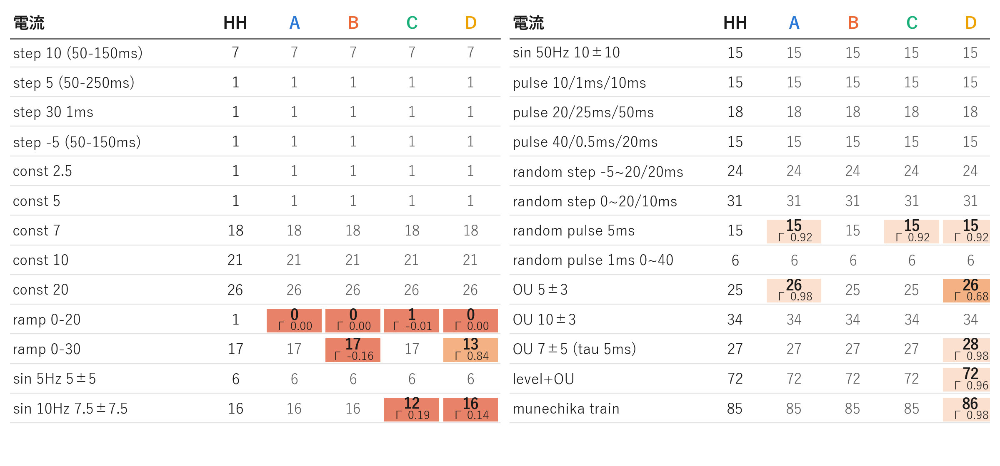
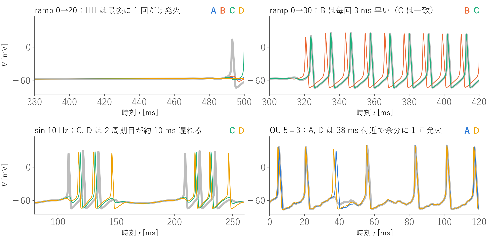

# 4 モデルの生データ（開発用テスト 26 本）

11/25 の発表の 9・10 枚目の元データ。各モデルの学習の結果ファイル（`results/<フォルダ>/<タグ>.json` の `test`）から`results/slides_1125/make_raw_md.py` で作った。Excel の「生データ一覧」と同じ値。

## 4 モデル

| 分野 | 構成 | タグ | 平均 Γ | 全スパイク一致の本数 |
|---|---|---|---:|---:|
| A | MLP | `r8_mlp_hd_w256` | 0.958 | 23 / 26 |
| B | RNN | `sp_r_init` | 0.917 | 24 / 26 |
| C | MLP 3 個 | `m3_hdf_s0` | 0.927 | 23 / 26 |
| D | RNN 3 個 | `p_h64_cl1` | 0.904 | 18 / 26 |

## 表の読み方

- 1 行が 1 本のテスト電流。**HH** の列は正解のスパイク数、**A〜D** の列は各モデルが閉ループで出したスパイク数
- 数字だけのセルは、すべてのスパイクが HH と ±2 ms 以内で一致した電流（Γ = 1）
- **太字（Γ）** のセルは外した電流。括弧の中がその電流の Γ（1 = 完全一致、0 = 偶然と同じ、負 = 偶然より悪い）
- 本数が同じでも外すことがある。例：B の ramp 0-30 は 17 本どうしだが、全部が約 3 ms 早いので Γ = −0.16
- 平均 Γ は 26 本の Γ の平均。Γ がほぼ 0 の電流が 1 本あると、平均は約 1/26 ≈ 0.04 下がる

## 電流ごとの結果

| 電流 | HH | A | B | C | D |
|---|---:|---:|---:|---:|---:|
| step 10 (50-150ms) | 7 | 7 | 7 | 7 | 7 |
| step 5 (50-250ms) | 1 | 1 | 1 | 1 | 1 |
| step 30 1ms | 1 | 1 | 1 | 1 | 1 |
| step -5 (50-150ms) | 1 | 1 | 1 | 1 | 1 |
| const 2.5 | 1 | 1 | 1 | 1 | 1 |
| const 5 | 1 | 1 | 1 | 1 | 1 |
| const 7 | 18 | 18 | 18 | 18 | 18 |
| const 10 | 21 | 21 | 21 | 21 | 21 |
| const 20 | 26 | 26 | 26 | 26 | 26 |
| ramp 0-20 | 1 | **0**（Γ 0.00） | **0**（Γ 0.00） | **1**（Γ -0.01） | **0**（Γ 0.00） |
| ramp 0-30 | 17 | 17 | **17**（Γ -0.16） | 17 | **13**（Γ 0.84） |
| sin 5Hz 5±5 | 6 | 6 | 6 | 6 | 6 |
| sin 10Hz 7.5±7.5 | 16 | 16 | 16 | **12**（Γ 0.19） | **16**（Γ 0.14） |
| sin 50Hz 10±10 | 15 | 15 | 15 | 15 | 15 |
| pulse 10/1ms/10ms | 15 | 15 | 15 | 15 | 15 |
| pulse 20/25ms/50ms | 18 | 18 | 18 | 18 | 18 |
| pulse 40/0.5ms/20ms | 15 | 15 | 15 | 15 | 15 |
| random step -5~20/20ms | 24 | 24 | 24 | 24 | 24 |
| random step 0~20/10ms | 31 | 31 | 31 | 31 | 31 |
| random pulse 5ms | 15 | **15**（Γ 0.92） | 15 | **15**（Γ 0.92） | **15**（Γ 0.92） |
| random pulse 1ms 0~40 | 6 | 6 | 6 | 6 | 6 |
| OU 5±3 | 25 | **26**（Γ 0.98） | 25 | 25 | **26**（Γ 0.68） |
| OU 10±3 | 34 | 34 | 34 | 34 | 34 |
| OU 7±5 (tau 5ms) | 27 | 27 | 27 | 27 | **28**（Γ 0.98） |
| level+OU | 72 | 72 | 72 | 72 | **72**（Γ 0.96） |
| munechika train | 85 | 85 | 85 | 85 | **86**（Γ 0.98） |

## 外した電流の中身

灰色の太線が HH、色の線が外したモデル（A 青、B 橙、C 緑、D 黄）。

| 電流 | 何が起きたか（スパイク時刻 [ms]） |
|---|---|
| ramp 0→20 | HH は 492.9 ms に 1 回だけ発火。A, B, D は発火しない。C は 499.9 ms（7 ms 遅れ） |
| ramp 0→30 | B は 17 回とも約 3 ms 早い（HH 323.5 に対して 320.5）。C は一致、D は 368.3 ms まで発火しない |
| sin 10 Hz | 2 周期目の最初のスパイクが HH 108.9、C 118.8、D 117.3。C はこの後 4 本足りなくなる |
| OU 5±3 | HH が発火しない 38 ms 付近で、A（37.9）と D（36.4）が余分に 1 回発火 |

## 気をつけること

- **RMSE だけで良し悪しは決められない**。A の const 7 は 18 本すべて一致（Γ = 1）だが、RMSE は 14.6 mV ある。スパイクは幅が約 1 ms と細いので、1 ms ずれるだけで波形の差が大きくなる
- 26 本は作り方を決めるのに使った開発用のデータ。最終の比較には最終テスト 54 本を使う（未実施）
- どのモデルも学習の seed は 1 本なので、seed によるばらつきはまだ見ていない
